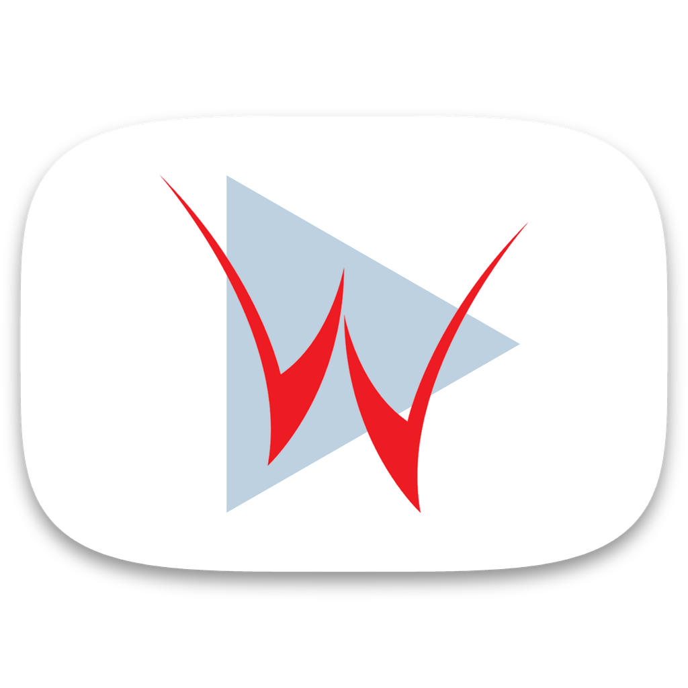
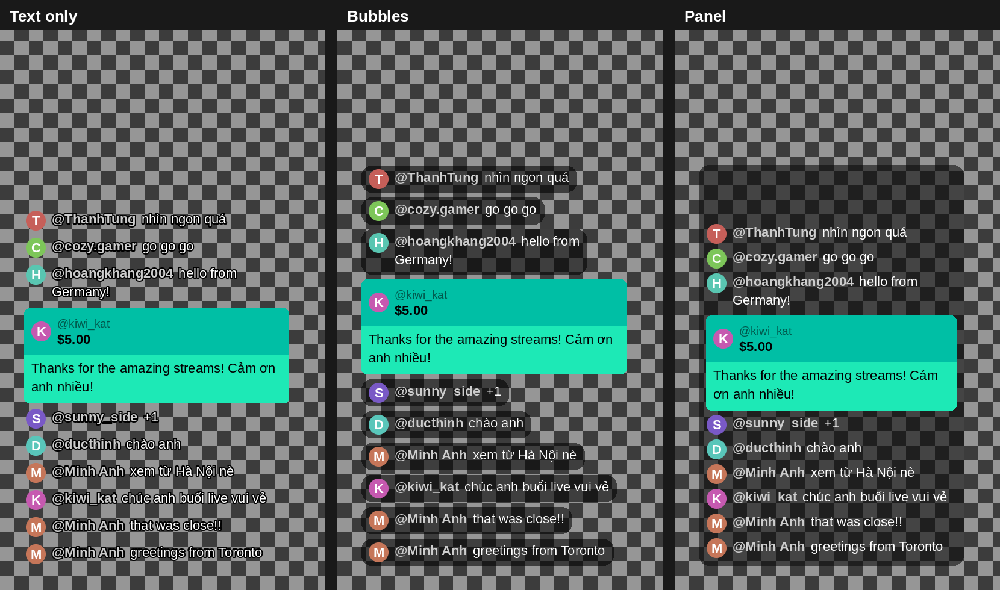

<p align="center"></p>

<h1 align="center">YouTube Live Chat Overlay</h1>

<p align="center">
  <b>Turn a YouTube live-chat replay into a transparent, frame-accurate video you can drop onto your footage.</b><br>
  Download streams too: sharpest AV1, or VP9 converted for DaVinci Resolve and Premiere.
</p>

<p align="center">
  <a href="https://github.com/Friendzoner49/youtube-chat-overlay/releases/latest"></a>
  <a href="https://github.com/Friendzoner49/youtube-chat-overlay/releases"></a>
  
  <a href="LICENSE"></a>
</p>

<p align="center"><b>English</b> · <a href="README.vi.md">Tiếng Việt</a></p>

<p align="center"></p>

## Download

No Python needed. Unzip and run.

| Platform | Download | Size | Notes |
|---|---|---|---|
| **Windows** 10 / 11 (64-bit) | [**ChatOverlay-windows.zip**](https://github.com/Friendzoner49/youtube-chat-overlay/releases/latest/download/ChatOverlay-windows.zip) | ~23 MB | Unzip, run `ChatOverlay.exe` |
| **macOS** (Apple Silicon) | [**ChatOverlay-macos.zip**](https://github.com/Friendzoner49/youtube-chat-overlay/releases/latest/download/ChatOverlay-macos.zip) | ~21 MB | Unsigned: see [first launch on macOS](#macos-first-launch) |

All releases and change notes: [Releases](https://github.com/Friendzoner49/youtube-chat-overlay/releases). Builds are produced automatically by GitHub Actions from this repository.

**You also need [FFmpeg](https://ffmpeg.org/download.html)** (not bundled):
Windows `winget install Gyan.FFmpeg` · macOS `brew install ffmpeg`. Or put `ffmpeg.exe` and `ffprobe.exe` next to the app.

Prefer running from source? See [Run from source](#run-from-source).

## What it does

**Chat overlay**
- **Frame-accurate sync** using the timestamps YouTube stores for every message.
- **Messages appear one at a time**, at least 0.1 s apart, with a short slide-up. A burst is spread evenly around its real time instead of only being pushed later, so the chat stays within about a second of real time.
- **Three looks:** outlined text, translucent bubbles, or a YouTube-style panel. Avatars, YouTube and Unicode emoji, owner / moderator / member / verified badges, Super Chats, Super Stickers and memberships are supported.
- **Exports only the chat-box area** at native resolution, so files stay small and sharp. Drop the clip into a corner of your timeline.
- **Compact transparent files.** Each distinct frame is compressed once and repeated frames share data inside the MOV: a 90-second 60 fps clip needs 761 compressed frames instead of 5,400.
- **Catches mismatched files** before rendering (stream date, file names, video IDs, length) and asks before continuing.
- **Render just the part you need** (start / end time); the file name records the range.
- **Outputs:** ProRes 4444, FFV1 lossless, QuickTime Animation, VP9 WebM (all transparent); green-screen MP4; or burn the chat straight into the video with GPU encoding (NVIDIA, Intel, AMD, Apple).

**Download video**
- One button: reads the format list, picks the best stream, downloads and merges it. Max resolution is your choice.
- **AV1 available →** sharpest AV1 + AAC audio, merged into an `.mp4`, untouched.
- **No AV1 →** sharpest VP9, converted with FFmpeg (`h264_nvenc`, VBR 15 Mbit/s, AAC 320k) to `_final.mp4`, which DaVinci Resolve and Premiere open reliably.
- **Video only / audio only.** Audio only saves the original **m4a (AAC)**, with no re-encoding.
- Progress bar, Cancel, and resume after a dropped connection.

**Everything else:** download the chat straight from a link, bilingual GUI (English / Tiếng Việt), a full command line, and in-app **yt-dlp updates**.

## Quick start

1. **Get the chat.** Open the app, paste the YouTube link and press **Download chat** (or pick an existing `.live_chat.json`).
2. **Pick the source video** (recommended; the app only reads its size, frame rate and length).
3. **Choose the output, style and position**, optionally a *Start* / *End* time, then press **Preview image** and **Export video**.
4. **Place it in your editor.** The log prints the exact DaVinci Resolve position values; see [Placing the overlay in DaVinci Resolve](#placing-the-overlay-in-davinci-resolve).

### Typical workflow for long streams

If you cut highlights from a multi-hour stream, render the chat **only for each highlight**: set *Start* and *End* to the highlight's position in the original stream (e.g. `1:02:00` → `1:10:00`), export, then put the overlay above the matching clip at the same frame. Rendering a whole multi-hour stream as a transparent intra-frame video takes a lot of disk space (see [Which output format?](#which-output-format)).

## Download video tab

Paste a link, choose a folder and (optionally) a maximum resolution, then press **Download video**. FFmpeg is required.

1. The app reads the format list (the same data as `yt-dlp --list-formats`, shown in the log).
2. If an **AV1** stream exists, it downloads the sharpest AV1 (within your cap) plus AAC audio and merges them into an `.mp4`. If YouTube offers a *higher* resolution in VP9 than in AV1, VP9 is used so you don't lose sharpness.
3. If there is no AV1, it downloads the sharpest **VP9** and converts it to `<name>_final.mp4` (`h264_nvenc`, preset p7, VBR 15 Mbit/s, AAC 320k). Without an NVIDIA GPU it falls back to the CPU (`libx264`, much slower). Tick *Delete the VP9 source* if you only want the `_final.mp4`.
4. If a download is cut off (VPN, network), press the button again: the part already downloaded is kept and resumed.

**Download** lets you take only what you need: *Video + audio* (default), *Video only* or *Audio only*. Audio only keeps the original m4a (AAC) track, so editors open it directly and the quality is exactly what YouTube stores. If a video has no m4a, the best other audio is used and the log says so. Files get a `_video` / `_audio` suffix so they never overwrite a video + audio download.

HDR streams are avoided whenever an SDR version exists; DRM-protected and Premium-only streams are skipped. Age-restricted or members-only videos use the same `cookies.txt` as the chat download.

### Keeping yt-dlp up to date

YouTube changes often, so the app can update yt-dlp itself. About **once a month** it checks GitHub for a newer yt-dlp when it starts and asks before doing anything; the **Check for yt-dlp update** button does it any time. The official file is downloaded from the yt-dlp release, verified against that release's SHA-256 checksum, and stored in a `yt-dlp-update` folder next to `settings.json`. Restart the app to use it. The tab shows the version in use (✔ = an updated copy is active). This works the same for the Windows build, the macOS app and running from source.

## Age-restricted and members-only videos

These need your YouTube login cookies, saved as `cookies.txt` in the download folder (the app then uses it automatically):

- **Without closing the browser (Windows, recommended):** load the small [`browser-extension/`](browser-extension) once (`chrome://extensions` → Developer mode → Load unpacked; see its README). After that, **Get cookies** in the app talks to the extension over a local native-messaging link and saves `cookies.txt` automatically. It uses the browser's official extension API, not the browser's locked cookie file.
- **With the browser closed:** pick your browser next to **Get cookies** and press it. The cookie database is locked while the browser runs, so close it completely (including background / tray processes) or you get a "could not copy cookie database" message.

## Installation details

### macOS first launch

The app is unsigned, so the first launch needs one extra step:

```bash
xattr -dr com.apple.quarantine ChatOverlay.app     # removes the Gatekeeper quarantine flag
```

Or right-click `ChatOverlay.app` → **Open** → confirm (only once). Apps started from Finder don't inherit a Terminal's `PATH`, so FFmpeg is also looked up in `/opt/homebrew/bin` and `/usr/local/bin`.

### Run from source

Requirements: Python 3.8+, FFmpeg (`ffmpeg` and `ffprobe` on `PATH`), and the packages in `requirements.txt` ([Pillow](https://python-pillow.org/), [yt-dlp](https://github.com/yt-dlp/yt-dlp)).

```bash
pip install -r requirements.txt
python chat_overlay.py            # opens the GUI
```

- **Windows, no console window:** double-click **`ChatOverlay.pyw`**. The first run installs missing packages; no administrator rights needed.
- **macOS with Homebrew Python:** the GUI needs Tk: `brew install python-tk`.

### Build it yourself

```bat
pip install -r requirements.txt pyinstaller
python build_exe.py
```

Windows: produces the folder `ChatOverlay\` (about 43 MB) with `ChatOverlay.exe`; keep the folder together. Settings live in `settings.json` next to the `.exe` and survive rebuilds; `build_exe.py` also updates yt-dlp first.

macOS:

```bash
pyinstaller --noconfirm --clean --windowed --name ChatOverlay --icon assets/icon.png \
  --exclude-module PIL._avif --add-data "assets:assets" chat_overlay.py
```

The result is `dist/ChatOverlay.app`.

## Using the app: details

- **Chat download** is the same as `yt-dlp --write-subs --sub-langs live_chat --skip-download URL`. If **Chat download folder** is blank, the chat goes next to the selected video, or into Downloads.
- **Settings** (language, folders, style, format, sizes…) are remembered in `settings.json` next to the app, so nothing is written to your system drive. Only if that folder is read-only does the app use `%APPDATA%\ChatOverlay\` (Windows) or `~/.config/ChatOverlay/`.

### Work folder (temp files & caches)

Everything written while processing goes into one **work folder**:

| Subfolder | Contents |
|---|---|
| `temp/` | temporary frames (several GB for long chats, deleted after each export), plus temp files from Python, FFmpeg and yt-dlp |
| `cache/` | downloaded avatars, emoji and badges (reused next time) |
| `yt-dlp-cache/` | yt-dlp's small cache |

By default this is `work/` next to the app (on macOS, a frozen `.app` uses `~/Library/Application Support/ChatOverlay/work`). To keep your system drive free, pick a folder on another fast drive in **Work folder (temp files + cache)**, e.g. `D:\LivechatTemp`. It is remembered.

## Which output format?

| Output | Transparent | Size (chat box, 1080p 60 fps, busy chat, per minute) | Best for |
|---|---|---|---|
| **ProRes 4444 XQ** (`prores`, default) | yes | ~130 MB | **DaVinci Resolve** and any other editor; the safest choice |
| **FFV1 lossless** (`ffv1`) | yes | ~50 MB | DaVinci Resolve (FFV1 RGBA is listed as supported by Blackmagic). Pixel-exact and smaller; test it once |
| **QuickTime Animation** (`mov`) | yes | ~100 MB | Premiere Pro, After Effects, Final Cut. DaVinci reads it **without** transparency |
| **VP9 WebM** (`webm`) | yes | ~6 MB | OBS, browsers |
| **Green-screen MP4** (`green`) | via chroma key | small | any editor (GPU encoding) |
| **Burn-in MP4** (`burn`) | — | ≈ source | a finished video in one step (GPU encoding) |

Sizes were measured on a real chat; quiet stretches cost almost nothing.

**Why the GPU isn't used for transparent files:** GPU encoders (NVENC, Quick Sync, AMF) only produce H.264 / HEVC / AV1 *without* alpha. Every transparent format editors read (ProRes 4444, FFV1, DNxHR 444) is encoded on the CPU. The app compensates by rendering frames on all CPU cores, compressing each distinct frame once, and exporting only the chat-box area. The GPU is used for green-screen and burn-in.

### Placing the overlay in DaVinci Resolve

After an export, the log prints something like:

```
DaVinci: Inspector → Retime and Scaling → Scaling = Crop (keeps 1:1 pixels, sharpest),
         then Transform → Position X = -700, Y = -67 (timeline 1920x1080) to place it where you chose
```

1. Put the overlay on the track above your clip, starting at the matching frame.
2. In the **Inspector**, set **Retime and Scaling → Scaling** to **Crop**. Otherwise DaVinci scales the small clip up and the text gets blurry.
3. Enter the printed **Position X/Y** under **Transform**. The values assume the timeline has the same resolution as your source video.

If an editor has trouble reading a file, untick **Share identical frames** (or use `--no-share`). Files get larger, but the frames are identical.

## Command line

```bash
# ProRes overlay for 1:02:00–1:10:00, size/fps taken from the source video
python chat_overlay.py stream.live_chat.json --video stream.mp4 --format prores --start 1:02:00 --end 1:10:00

# Download the chat from a link, then render
python chat_overlay.py "https://www.youtube.com/watch?v=VIDEO_ID" --video stream.mp4 --format ffv1

# Preview a single frame at 25:30
python chat_overlay.py stream.live_chat.json --video stream.mp4 --preview 25:30

# Burn the chat into the video with the GPU
python chat_overlay.py stream.live_chat.json --video stream.mp4 --format burn --encoder hevc_nvenc
```

Run `python chat_overlay.py --help` for all options:

- Style: `--style`, `--position`, `--margin-x`, `--margin-y`, `--box-width`, `--font-size`.
- Message flow: `--max-messages`, `--min-gap`, `--anim`, `--hide-after`.
- Timing: `--offset`.
- Safety: `--ignore-mismatch` renders even if the chat and the video look like different streams.
- Output: `--format` (default `prores`), `--canvas box|full`, `--no-share`, `--lang`.
- Folders: `--work-dir`, `--temp-dir`, `--cache-dir`, `--download-dir`.

### Customising the position

Pick one of six positions in the GUI, then fine-tune the distance to the frame edges with `--margin-x` / `--margin-y`, or in `class Options` in `chat_overlay.py`:

```python
margin_x: int = 40   # left/right, px at 1080p (scaled automatically for 1440p/4K)
margin_y: int = 40   # top/bottom
```

These margins are also used to compute the DaVinci *Position X/Y* printed in the log. You can always move the clip freely in your editor afterwards.

## Troubleshooting

- **"ffmpeg not found":** install FFmpeg and add its `bin` folder to `PATH`, or copy `ffmpeg.exe` and `ffprobe.exe` next to the app.
- **Chat download fails:** press **Check for yt-dlp update** in the Download video tab (YouTube changes often). Only past livestreams with chat replay enabled have a chat to download. Age-restricted or members-only streams need `cookies.txt`.
- **Connection drops while downloading:** long chats need hundreds of requests in a row. The app retries each request up to 10 times and re-fetches the same part up to 3 more rounds, so it continues where it stopped. The log shows `⚠ Connection lost…`. If it still fails, check your network and try disabling VPN or your antivirus's HTTPS scanning.
- **Disk space:** distinct frames are rendered to a temporary folder before encoding, roughly 1–1.5 GB per hour of chat at 1080p. Point the *Work folder* to a drive with free space. Setting *Slide animation* to `0` cuts the number of frames about sixfold.
- **Fonts:** Segoe UI / Arial / Roboto / Noto Sans / DejaVu are detected automatically. To use your own, drop `Roboto-Regular.ttf` and `Roboto-Medium.ttf` into a `fonts/` folder next to the app, or use `--font` and `--font-bold`.
- **Chat reacts a few seconds after the action:** each message keeps the time it reached YouTube, like YouTube's own replay, and viewers watched with a few seconds of latency. Set *Time offset* to a negative value (e.g. `-5`) to show messages earlier.
- **Blurry chat in DaVinci:** set *Scaling = Crop* on the clip.
- **"Permission denied" when saving:** a bare file name in *Save as* is saved next to the chat file. Check that the folder is writable and the output isn't open in your editor.
- **Double-clicking `ChatOverlay.pyw` says "Activation is blocked due to the .appinstaller update settings":** `.pyw` is opened by Windows' *Python Install Manager*, which Windows blocks when an update can't install automatically. Update it with `Add-AppxPackage -AppInstallerFile https://www.python.org/ftp/python/pymanager/pymanager.appinstaller` in PowerShell (end `pyshellext.exe` in Task Manager if it says the app is in use), or use the standalone `.exe` from [Download](#download).

## How it works

1. Messages are read from the yt-dlp JSON (`videoOffsetTimeMsec`) and queued so each appears at least `min_gap` after the previous one.
2. Each message is drawn once with Pillow.
3. Only the frames where the chat actually changes are rendered, in parallel on all CPU cores.
4. FFmpeg compresses each distinct frame once, as an image sequence at the exact frame rate.
5. The app rewrites the MOV sample table so every output frame points at the right compressed frame. Repeated frames share data and the result is a normal constant-frame-rate MOV. Other formats are converted from a lossless intermediate built the same way.

In testing, all eight output types had exactly the expected number of frames, and every sampled frame (including mid-animation frames at 60 fps) showed the right chat state at the right time.

## License

[MIT](LICENSE).

Third-party components:
- [FFmpeg](https://ffmpeg.org/legal.html) (LGPL/GPL): **not** bundled, installed separately.
- [Pillow](https://github.com/python-pillow/Pillow/blob/main/LICENSE) (MIT-CMU) and [yt-dlp](https://github.com/yt-dlp/yt-dlp/blob/master/LICENSE) (Unlicense): bundled in the release builds.

Please respect YouTube's Terms of Service and the privacy of your viewers when publishing chat content.
