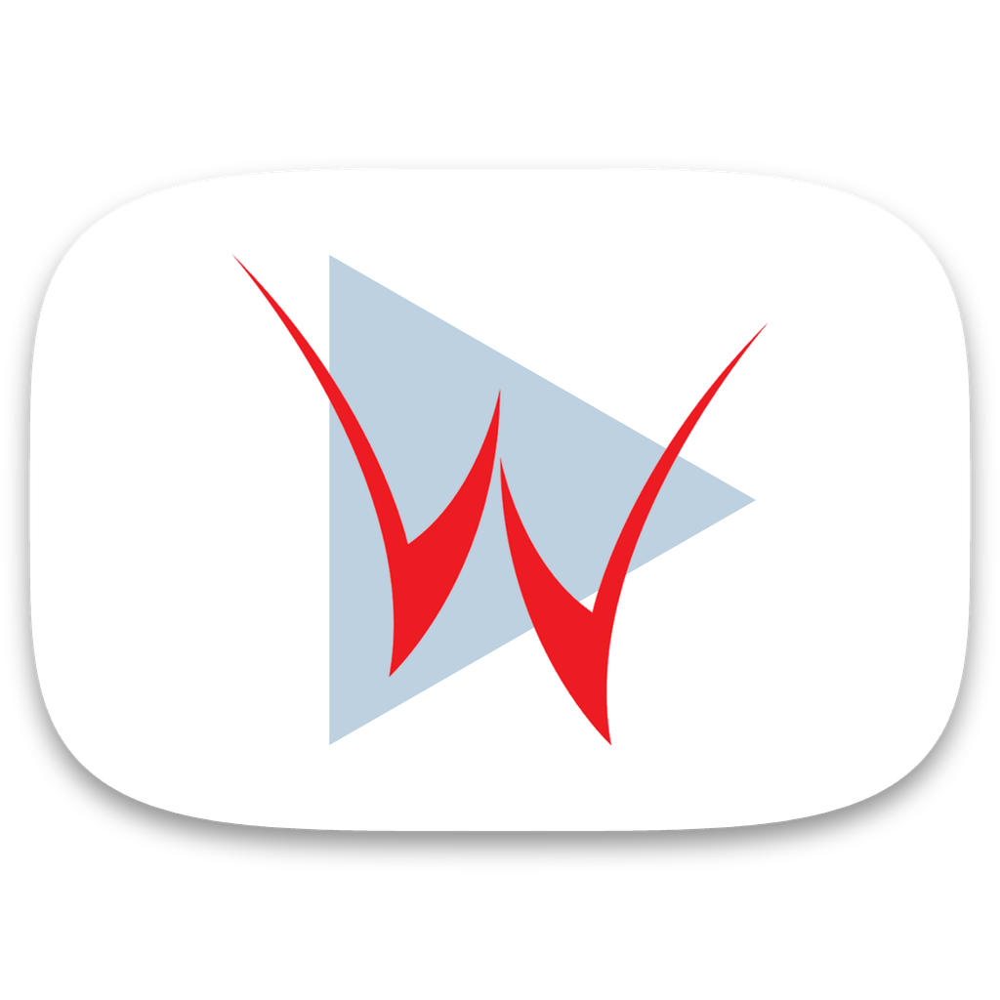
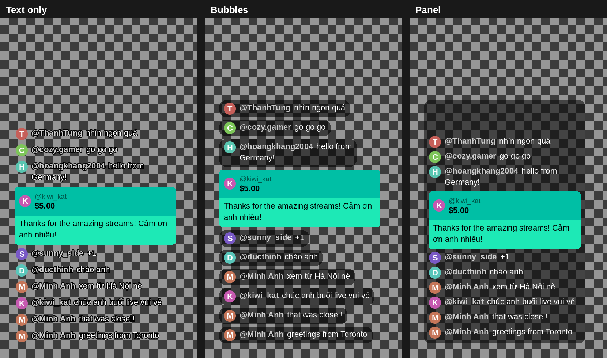

<p align="center"></p>

<h1 align="center">YouTube Live Chat Overlay</h1>

<p align="center"><a href="README.md">English</a> · <b>Tiếng Việt</b></p>

Biến phần live chat (chat replay) của một buổi livestream YouTube thành **video khung chat nền trong suốt**, khớp đúng thời gian với buổi live, để đặt chồng lên video trong DaVinci Resolve, Premiere Pro, Final Cut, CapCut…



## Tải về

Các bản build sẵn (không cần cài Python) được đính kèm ở mỗi [Release](../../releases/latest), do GitHub Actions tự build:

- **Windows:** `ChatOverlay-windows.zip` → giải nén, chạy `ChatOverlay.exe`.
- **macOS (Apple Silicon):** `ChatOverlay-macos.zip` → giải nén, xem mục [bản `.app` cho macOS](#macos-bản-app-chạy-độc-lập) bên dưới trước khi mở.

Hoặc chạy từ mã nguồn / tự build (xem bên dưới) trên mọi nền tảng, kể cả Windows x86/x64, Mac Intel và Linux.

## Tính năng

- **Khớp thời gian chính xác đến từng khung hình**, dựa trên mốc thời gian YouTube lưu cho từng tin nhắn.
- **Tin nhắn hiện lần lượt.** Khi nhiều người chat cùng lúc, các tin được xếp hàng, cách nhau ít nhất 0,1 giây (chỉnh được), kèm hiệu ứng trượt lên ngắn. Một đợt tin dồn được dàn đều quanh mốc thật (vài tin sớm, vài tin muộn một chút) thay vì chỉ đẩy lùi về sau; nếu dồn nhiều, hàng chờ tự chạy nhanh hơn, nên chat luôn lệch không quá khoảng 1 giây so với thực tế.
- **Tối đa N tin trên màn hình** (mặc định 10). Tin cũ trượt ra và mờ dần ở mép trên.
- **3 giao diện:** chỉ chữ có viền, bong bóng mờ, hoặc khung nền kiểu YouTube.
- **Nội dung được hỗ trợ:** avatar, emoji YouTube và emoji thường, badge chủ kênh / quản trị viên / hội viên / đã xác minh, Super Chat, Super Sticker, hội viên mới. Tin bị xoá sẽ được bỏ qua.
- **Tải chat trực tiếp từ link YouTube** ngay trong app, vào thư mục bạn chọn; app ghi nhớ thư mục đó cho lần sau.
- **Mặc định chỉ xuất đúng vùng khung chat**, giữ nguyên độ phân giải gốc (ví dụ 440×866 px với video 1080p), nên file nhẹ và nét. Bạn chỉ cần đặt clip vào một góc trên timeline.
- **File trong suốt nhỏ và xuất nhanh.** Mỗi khung hình khác nhau chỉ nén một lần; các khung trùng nhau dùng chung dữ liệu trong file MOV. Ví dụ, 90 giây ở 60 fps chỉ cần nén 761 khung thay vì 5.400.
- **Phát hiện chọn nhầm file.** Trước khi xuất, app kiểm tra file chat và video có cùng một buổi live không: dựa vào ngày phát lưu trong file chat, ngày ghi trên tên hai file (`230917…`, `17⧸09⧸2023`, `2023-09-17`), mã video YouTube trong ngoặc vuông, và độ dài chat so với video. Nếu thấy lệch, app nói rõ lý do và hỏi bạn có muốn tiếp tục không.
- **Chỉ xuất đoạn cần dùng** (Bắt đầu/Kết thúc). Tên file ghi rõ đoạn thời gian, ví dụ `…_chat_overlay_1h02m00s-1h10m00s.mov`.
- **Định dạng trong suốt:** ProRes 4444, FFV1 (lossless), QuickTime Animation, WebM VP9. Ngoài ra có MP4 phông xanh, hoặc ghép thẳng vào video (mã hoá bằng GPU NVIDIA / Intel / AMD / Apple).
- **Giao diện song ngữ** Việt / Anh, kèm đầy đủ chế độ dòng lệnh.

## Yêu cầu

- **Python 3.8+.** Trên Windows, dùng bản cài từ [python.org](https://www.python.org/downloads/) và tick *“Add python.exe to PATH”*.
- **[FFmpeg](https://ffmpeg.org/download.html)**, có `ffmpeg` và `ffprobe` trong `PATH`. Cách khác: đặt `ffmpeg.exe` và `ffprobe.exe` cạnh `chat_overlay.py`.
- **Thư viện Python** trong `requirements.txt`: Pillow, và yt-dlp (chỉ cần khi tải chat từ link).

## Bắt đầu

### Windows (không hiện cửa sổ đen)

Bấm đúp **`ChatOverlay.pyw`**.

- Lần đầu chạy, app tự cài các thư viện còn thiếu.
- **Không cần quyền admin.**
- File `.pyw` được chạy bằng `pythonw.exe`, nên không có cửa sổ dòng lệnh.

Nếu bấm đúp mà file mở trong trình soạn thảo: chuột phải → *Open with* → *Python* (hoặc `pythonw.exe`). Muốn có lối tắt ngoài màn hình: chuột phải → *Send to* → *Desktop (create shortcut)*.

### Windows: bản `.exe` chạy độc lập

Build thành `ChatOverlay.exe` để bấm đúp là chạy, không cần Python. Cách này hữu ích khi lệnh `py` hoặc việc bấm đúp `.pyw` bị lỗi, hoặc khi muốn chép app sang máy khác:

```bat
pip install -r requirements.txt pyinstaller
python build_exe.py
```

- Kết quả là thư mục `ChatOverlay\` (khoảng 50 MB), bên trong có `ChatOverlay.exe`. Hãy giữ nguyên cả thư mục; bạn có thể chuyển hoặc chép nó đi đâu cũng được.
- Vẫn cần FFmpeg (có trong `PATH`, hoặc đặt `ffmpeg.exe`/`ffprobe.exe` cạnh `ChatOverlay.exe`).
- Cài đặt được lưu trong `settings.json` cạnh `ChatOverlay.exe`. Lần build đầu sẽ chép cài đặt từ bản script; các lần build lại vẫn giữ nguyên.
- yt-dlp được đóng gói sẵn trong `.exe`. Khi YouTube thay đổi làm tải chat bị lỗi, hãy chạy lại `python build_exe.py`: script sẽ cập nhật yt-dlp rồi mới build.
- Bản build là một thư mục thay vì một file duy nhất, nên khởi động nhanh và không tự giải nén vào `%TEMP%` mỗi lần chạy.

### macOS / Linux / chạy thủ công

```bash
pip install -r requirements.txt
python chat_overlay.py            # mở giao diện
```

Trên macOS dùng Python của Homebrew, giao diện cần Tk: chạy `brew install python-tk`. FFmpeg: `brew install ffmpeg`.

### macOS: bản .app chạy độc lập

Bản `ChatOverlay.app` dựng sẵn (Apple Silicon) được đính kèm ở mỗi [Release](../../releases/latest). App chưa ký chứng chỉ (unsigned), nên lần mở đầu cần thêm một bước:

```bash
xattr -dr com.apple.quarantine ChatOverlay.app     # gỡ cờ "quarantine" của Gatekeeper
```

Hoặc chuột phải vào `ChatOverlay.app` → **Open** → xác nhận trong hộp thoại (chỉ cần làm 1 lần).

Muốn tự build:

```bash
pip install -r requirements.txt pyinstaller
pyinstaller --noconfirm --clean --windowed --name ChatOverlay --icon assets/icon.png --add-data "assets:assets" chat_overlay.py
```

Kết quả nằm ở `dist/ChatOverlay.app`. Vẫn cần FFmpeg (`brew install ffmpeg`); app tìm trong `PATH`, nếu không thấy sẽ thử `/opt/homebrew/bin` và `/usr/local/bin` vì app mở từ Finder không kế thừa `PATH` của Terminal.

## Cách dùng

1. **Lấy file chat**, một trong hai cách:
   - dán link YouTube rồi bấm **Tải chat**, hoặc
   - chọn file `.live_chat.json` có sẵn.

   Tải chat tương đương lệnh `yt-dlp --write-subs --sub-langs live_chat --skip-download URL`. Dùng ô **Thư mục lưu chat tải về** để chọn nơi lưu; app ghi nhớ thư mục này cho các lần mở sau. Nếu để trống, file được lưu cạnh video gốc đã chọn, hoặc trong thư mục Downloads.

   **Video giới hạn tuổi hoặc dành riêng cho hội viên** cần cookies đăng nhập YouTube, lưu thành file `cookies.txt` trong thư mục lưu chat (app sẽ tự dùng file này cho mọi lần tải sau):
   - **Không cần đóng trình duyệt (Windows, khuyến nghị):** nạp tiện ích nhỏ [`browser-extension/`](browser-extension) có sẵn trong repo này 1 lần (`chrome://extensions` → bật Developer mode → Load unpacked — xem README của tiện ích để biết chi tiết). Từ đó, bấm nút **Lấy cookies** trong app sẽ tự nói chuyện thẳng với tiện ích qua kết nối native-messaging cục bộ và lưu `cookies.txt` luôn — không cần bấm gì thêm trong trình duyệt, trình duyệt cũng không cần đóng. Tiện ích đọc cookie qua đúng API chính thức của trình duyệt, giống cách tiện ích *Get cookies.txt LOCALLY* hoạt động, không đụng tới file cookie đang bị khoá của trình duyệt.
   - **Khi đã đóng trình duyệt:** chọn trình duyệt ở ô cạnh nút **Lấy cookies** trong app rồi bấm. Cách này đọc thẳng file database cookie của trình duyệt, chỉ chạy được khi trình duyệt không mở — file đó bị khoá lúc đang chạy, nên nút sẽ báo lỗi "could not copy cookie database" cho tới khi bạn đóng hẳn trình duyệt (kể cả tiến trình nền/khay hệ thống).
2. **(Nên làm) Chọn video gốc.** App chỉ đọc kích thước, FPS và độ dài, không mã hoá lại video, trừ khi bạn chọn *Ghép thẳng vào video gốc*. Nếu không chọn video, hãy điền *Khung hình* và *FPS*; để trống thì mặc định 1920×1080, 30 fps.
3. **Chọn kiểu xuất, giao diện, vị trí**, và nhập *Bắt đầu*/*Kết thúc* nếu chỉ cần một đoạn.
4. Bấm **Xem thử ảnh** để kiểm tra, rồi **Xuất video**.

Cài đặt (ngôn ngữ, thư mục lưu chat, thư mục làm việc, giao diện, định dạng, kích thước…) được ghi nhớ giữa các lần mở. File cài đặt là `settings.json` nằm cạnh `chat_overlay.py`, nên không ghi gì vào ổ hệ thống. Chỉ khi thư mục đó không ghi được, app mới dùng `%APPDATA%\ChatOverlay\` (Windows) hoặc `~/.config/ChatOverlay/`. Cài đặt của bản cũ trong `%APPDATA%` được tự chuyển sang rồi xoá.

### Tab Tải video

Tab **Tải video** tải chính buổi live về. Dán link, chọn thư mục và (nếu muốn) độ phân giải tối đa, rồi bấm **Tải video** — cần FFmpeg như phần còn lại của app.

1. App đọc danh sách định dạng (cùng dữ liệu với `yt-dlp --list-formats`, hiện trong ô log).
2. Nếu có **AV1**, app tải AV1 nét nhất (trong giới hạn bạn chọn) cùng tiếng AAC rồi ghép thành `.mp4`, giữ nguyên chất lượng. (Nếu YouTube có VP9 độ phân giải *cao hơn* AV1 thì dùng VP9 để không mất độ nét.)
3. Nếu không có AV1, app tải **VP9** nét nhất rồi đổi bằng FFmpeg (`h264_nvenc`, preset p7, VBR 15 Mbit/s, AAC 320k) thành `<tên>_final.mp4` — DaVinci Resolve và Premiere đọc chắc chắn. Máy không có card NVIDIA thì tự đổi bằng CPU (`libx264`, chậm hơn nhiều). Tick *Xoá file VP9 gốc* nếu chỉ cần file `_final.mp4`.
4. Nếu đang tải bị đứt (VPN, mạng), bấm nút lần nữa: phần đã tải được giữ lại và tải tiếp.

Ô **Tải gì** cho phép chỉ lấy phần cần dùng: *Hình + tiếng* (mặc định), *Chỉ hình* hoặc *Chỉ tiếng*. *Chỉ tiếng* lưu đúng đường tiếng **m4a (AAC)** gốc, không đụng tới — DaVinci Resolve, Premiere… nạp thẳng được và không bị đổi mã, nên chất lượng giữ nguyên như YouTube lưu. (Video nào không có m4a thì lấy bản tiếng tốt nhất còn lại và ghi chú trong ô log.) *Chỉ hình* theo cùng quy tắc AV1 / VP9 ở trên; file có đuôi tên `_video` / `_audio` nên không đè lên file hình + tiếng đã tải.

**Giữ yt-dlp luôn mới.** YouTube hay đổi nên app tự cập nhật được yt-dlp. Mỗi lần mở, nếu đã hơn **1 tháng** chưa kiểm tra, app xem trên GitHub có yt-dlp mới không và hỏi trước khi làm gì; nút **Kiểm tra cập nhật yt-dlp** dùng được bất cứ lúc nào. File yt-dlp chính thức được tải từ bản phát hành của yt-dlp trên GitHub, đối chiếu mã SHA-256 của chính bản đó, rồi lưu vào thư mục `yt-dlp-update` cạnh `settings.json` (mở lại app để dùng). Tab hiện phiên bản đang dùng (✔ = đang dùng bản đã cập nhật). Cách này giống nhau cho `.exe` Windows, `.app` macOS và chạy từ mã nguồn.

Bản HDR được tránh khi có bản SDR (video chỉ có AV1 dạng HDR thì chọn VP9 SDR), còn bản có DRM hoặc chỉ dành cho Premium thì bị bỏ qua. Video giới hạn tuổi / dành cho hội viên dùng chung file `cookies.txt` với phần tải chat.

### Thư mục làm việc (file tạm + cache)

Mọi thứ app ghi ra trong lúc xử lý đều nằm trong một **thư mục làm việc**:

| Thư mục con | Nội dung |
|---|---|
| `temp/` | khung hình tạm (vài GB với chat dài, tự xoá sau mỗi lần xuất), cùng file tạm của Python, FFmpeg và yt-dlp |
| `cache/` | avatar, emoji, badge đã tải (dùng lại cho lần sau) |
| `yt-dlp-cache/` | cache nhỏ của yt-dlp |

Mặc định là thư mục `work/` cạnh script (trên macOS, bản `.app` đóng gói sẵn mặc định dùng `~/Library/Application Support/ChatOverlay/work` thay vì vậy, vì không nên ghi vào trong app bundle). Muốn không dùng ổ hệ thống (ví dụ ổ `C:`), chọn một thư mục trên ổ khác ở ô **Thư mục làm việc (file tạm + cache)**, ví dụ `D:\LivechatTemp`. App sẽ ghi nhớ thư mục này. Thư mục `chat_cache/` của bản cũ được tự chuyển sang đó.

Khi cài thư viện lần đầu, file khởi động trên Windows cũng dùng thư mục này cho file tạm và chạy pip không kèm cache tải về. Riêng bản thân các thư viện Python vẫn nằm ở nơi cài Python.

### Quy trình gợi ý cho buổi live dài

Nếu bạn cắt highlight từ buổi live vài tiếng, hãy **chỉ xuất chat cho từng đoạn**:

1. Đặt *Bắt đầu*/*Kết thúc* theo vị trí của đoạn đó trong buổi live gốc.
2. Xuất video.
3. Trong phần mềm dựng, đặt file chat lên track phía trên clip tương ứng, bắt đầu cùng khung hình. Tên file cho biết nó thuộc đoạn nào.

## Nên chọn định dạng nào?

| Kiểu xuất | Trong suốt | Dung lượng (vùng khung chat, 1080p 60 fps, chat đông, mỗi phút) | Phù hợp |
|---|---|---|---|
| **ProRes 4444 XQ** (`prores`, mặc định) | có | ~130 MB | **DaVinci Resolve** và mọi app khác; chắc chắn nhất |
| **FFV1 lossless** (`ffv1`) | có | ~50 MB | DaVinci Resolve (Blackmagic có liệt kê hỗ trợ FFV1 RGBA). Đúng từng điểm ảnh và nhẹ hơn; nên thử một lần trước |
| **QuickTime Animation** (`mov`) | có | ~100 MB | Premiere Pro, After Effects, Final Cut. DaVinci đọc được nhưng **mất** nền trong suốt |
| **WebM VP9** (`webm`) | có | ~6 MB | OBS, trình duyệt |
| **MP4 phông xanh** (`green`) | dùng chroma key | nhỏ | mọi app (mã hoá bằng GPU) |
| **Ghép thẳng** (`burn`) | — | ≈ video gốc | ra luôn video hoàn chỉnh (mã hoá bằng GPU) |

Dung lượng đo trên chat thật và phụ thuộc mức độ sôi nổi của chat: lúc chat vắng gần như không tốn gì.

**Vì sao file trong suốt không dùng GPU:** bộ mã hoá GPU (NVIDIA NVENC, Intel Quick Sync, AMD AMF) chỉ xuất H.264/HEVC/AV1 *không có* kênh trong suốt. Mọi định dạng trong suốt mà các phần mềm như DaVinci đọc được (ProRes 4444, FFV1, DNxHR 444) đều mã hoá bằng CPU. Để bù lại, app dựng khung hình trên tất cả nhân CPU, chỉ nén mỗi khung khác nhau một lần, và chỉ xuất đúng vùng khung chat. GPU được dùng cho hai chế độ phông xanh và ghép thẳng.

### Đặt khung chat vào DaVinci Resolve

Sau khi xuất, log in ra dạng:

```
DaVinci: Inspector → Retime and Scaling → Scaling = Crop (giữ nguyên kích thước, nét 1:1),
         rồi Transform → Position X = -700, Y = -67 (timeline 1920x1080) để đặt đúng vị trí đã chọn
```

1. Đặt file chat lên track phía trên clip, bắt đầu cùng khung hình.
2. Trong **Inspector**, đặt **Retime and Scaling → Scaling** = **Crop**. Nếu không, DaVinci sẽ phóng clip nhỏ lên cho vừa khung hình và chữ bị mờ.
3. Nhập **Position X/Y** đã in ra vào mục **Transform**. Khung chat sẽ nằm đúng vị trí và lề bạn đã chọn trong app. Các giá trị này giả định timeline có cùng độ phân giải với video gốc.

Nếu DaVinci (hoặc phần mềm khác) đọc file bị lỗi, hãy bỏ tick **Dùng chung khung trùng** (hoặc dùng `--no-share`). File sẽ nặng hơn nhưng hình hoàn toàn giống nhau.

## Dòng lệnh

```bash
# Xuất ProRes cho đoạn 1:02:00–1:10:00, kích thước/FPS lấy theo video gốc
python chat_overlay.py stream.live_chat.json --video stream.mp4 --format prores --start 1:02:00 --end 1:10:00

# Tải chat từ link vào thư mục chỉ định rồi xuất luôn
python chat_overlay.py "https://www.youtube.com/watch?v=VIDEO_ID" --download-dir "D:/Chat" --video stream.mp4 --format ffv1
```

An toàn: `--ignore-mismatch` vẫn xuất dù file chat và video có vẻ không cùng buổi live. Mặc định, lệnh sẽ dừng và giải thích lý do.

Đầu ra: `--format` (mặc định `prores`), `--canvas box|full` (mặc định `box`: chỉ vùng khung chat), `--no-share` (nén mọi khung thay vì dùng chung khung trùng).

Thư mục: `--work-dir` (mặc định: thư mục đã lưu trong giao diện, nếu không có thì `./work`). `--temp-dir` và `--cache-dir` dùng để ghi đè riêng từng thư mục con.

Nếu đưa link mà không có `--download-dir`, app dùng thư mục đã ghi nhớ trong giao diện, sau đó đến thư mục của video, cuối cùng là thư mục hiện tại. Xem mọi tuỳ chọn bằng `python chat_overlay.py --help`.

## Chỉnh vị trí khung chat

Trên giao diện, chọn 1 trong 6 vị trí. Để tinh chỉnh khoảng cách tới mép hình, sửa trong `chat_overlay.py`, phần `class Options`:

```python
margin_x: int = 40   # trái/phải, px theo 1080p (tự co giãn cho 2K/4K)
margin_y: int = 40   # trên/dưới – giảm số này để khung chat ở dưới hạ thấp hơn
```

Hoặc dùng dòng lệnh: `--margin-x 30 --margin-y 10`. Ở chế độ mặc định (chỉ xuất vùng khung chat), các lề này cũng được dùng để tính *Position X/Y* cho DaVinci in trong log. Sau đó bạn vẫn có thể kéo clip tự do trong phần mềm dựng.

## Mẹo và xử lý lỗi

- **“Không tìm thấy ffmpeg”**: cài FFmpeg và thêm thư mục `bin` vào `PATH`, hoặc chép `ffmpeg.exe` và `ffprobe.exe` cạnh file script.
- **Bấm đúp `ChatOverlay.pyw` báo "Activation is blocked due to the .appinstaller update settings"** (hoặc treo ở "Hang on while we get your app's information"): file `.pyw` đang được mở bằng ứng dụng *Python Install Manager*, và Windows chặn ứng dụng này khi có bản mới mà không tự cập nhật được. Hãy cập nhật thủ công bằng PowerShell: `Add-AppxPackage -AppInstallerFile https://www.python.org/ftp/python/pymanager/pymanager.appinstaller` (nếu báo ứng dụng đang chạy, hãy tắt `pyshellext.exe` trong Task Manager rồi chạy lại). Các bản Python và thư viện đã cài vẫn được giữ nguyên. Hoặc bỏ qua hẳn trình quản lý này: chuột phải ngoài desktop → *New → Shortcut*, nhập `"<đường dẫn>\pythonw.exe" "<đường dẫn>\ChatOverlay.pyw"` (`pythonw.exe` thường nằm trong `%LOCALAPPDATA%\Python\pythoncore-3.xx-64\`), rồi mở app bằng shortcut đó.
- **Tải chat lỗi**: cập nhật yt-dlp bằng `pip install -U yt-dlp` (hoặc build lại `.exe`/`.app`). Chỉ video đã từng livestream và còn bật chat replay mới có chat để tải. Video giới hạn tuổi hoặc dành riêng cho hội viên cần file `cookies.txt` — xem mục [Cách dùng](#cách-dùng) ở trên.
- **Rớt mạng khi tải chat** (ví dụ `SSL: UNEXPECTED_EOF_WHILE_READING`): chat dài cần hàng trăm yêu cầu liên tiếp nên rất dễ gặp chập chờn mạng. App tự thử lại mỗi yêu cầu tối đa 10 lần; nếu vẫn chưa được, app tải lại đúng đoạn đó thêm tối đa 3 vòng nữa, nên tải tiếp từ chỗ dừng chứ không tải lại từ đầu. Khi việc này xảy ra, log hiện dòng `⚠ Mất kết nối…`. Nếu vẫn lỗi, hãy kiểm tra mạng, thử tắt VPN hoặc tính năng quét HTTPS của phần mềm diệt virus.
- **Dung lượng đĩa**: các khung hình khác nhau được dựng vào thư mục tạm trước khi mã hoá, khoảng 1–1,5 GB cho mỗi giờ chat ở 1080p và nhiều hơn ở 2K. Hãy chọn *Thư mục làm việc* trên ổ còn trống. Đặt *Hiệu ứng trượt* = `0` giảm số khung hình khoảng 6 lần; tin vẫn hiện lần lượt.
- **Font**: app tự tìm Segoe UI / Arial / Roboto / Noto Sans / DejaVu. Muốn dùng font riêng, chép vào thư mục `fonts/` cạnh script, hoặc dùng `--font` và `--font-bold`.
- **Avatar và emoji** chỉ tải một lần, được lưu cache trong `<thư mục làm việc>/cache/`.
- **Chat phản ứng chậm vài giây so với hình**: mỗi tin giữ đúng thời điểm nó đến máy chủ YouTube, giống hệt phần chat replay trên YouTube. Người xem vốn xem live chậm vài giây rồi mới gõ, nên phản ứng luôn đến muộn. Đặt *Dời thời gian* âm (ví dụ `-3` đến `-8`, hoặc `--offset -5`) để mọi tin hiện sớm hơn.
- **Chữ bị mờ trong DaVinci**: đặt *Scaling = Crop* cho clip (xem mục “Đặt khung chat vào DaVinci Resolve”).
- **Lỗi “Permission denied” khi lưu**: nếu ô *Lưu thành* chỉ có tên file, file sẽ được lưu cạnh file chat. Hãy kiểm tra thư mục đích có quyền ghi, và file đích không đang mở trong phần mềm dựng (ví dụ DaVinci).

## Giấy phép

[MIT](LICENSE).

Công cụ bên thứ ba dùng khi chạy, không đóng gói kèm: FFmpeg (LGPL/GPL), Pillow (MIT-CMU), yt-dlp (Unlicense).

Khi đăng nội dung chat, hãy tôn trọng điều khoản của YouTube và quyền riêng tư của người xem.
